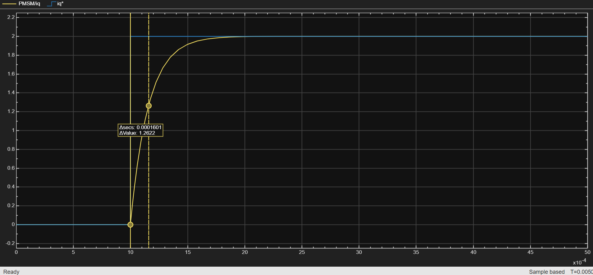
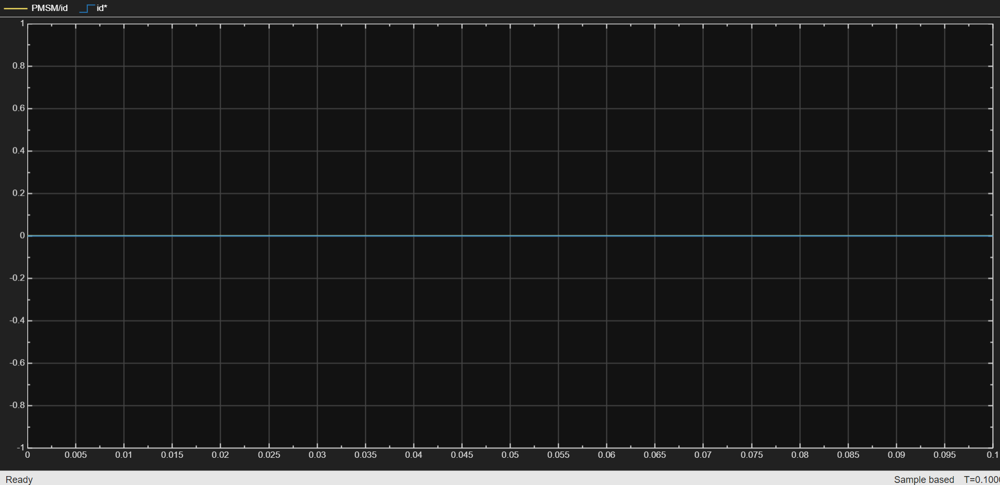
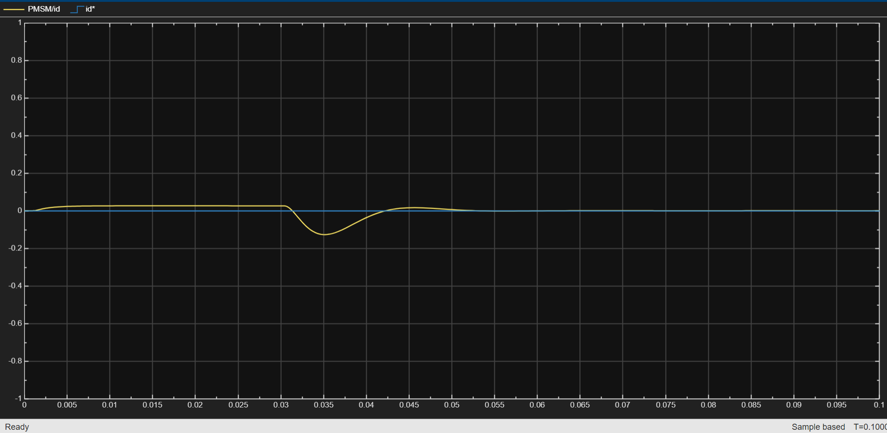
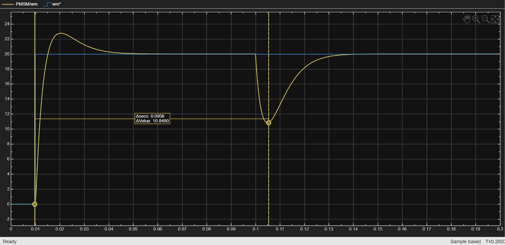
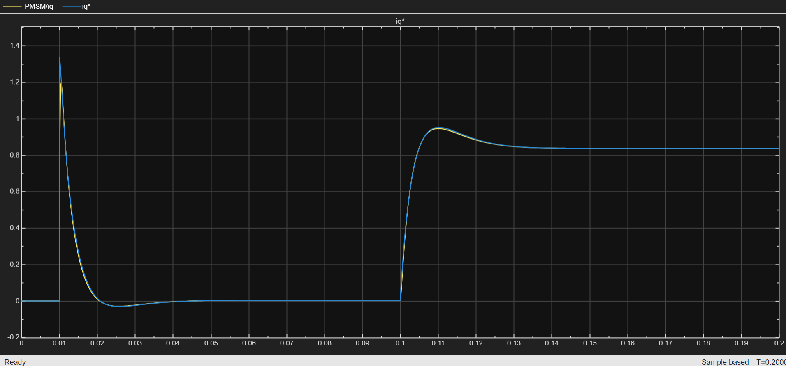
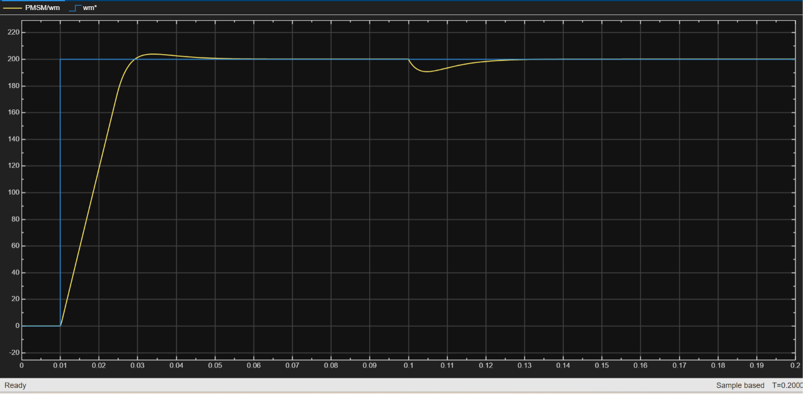
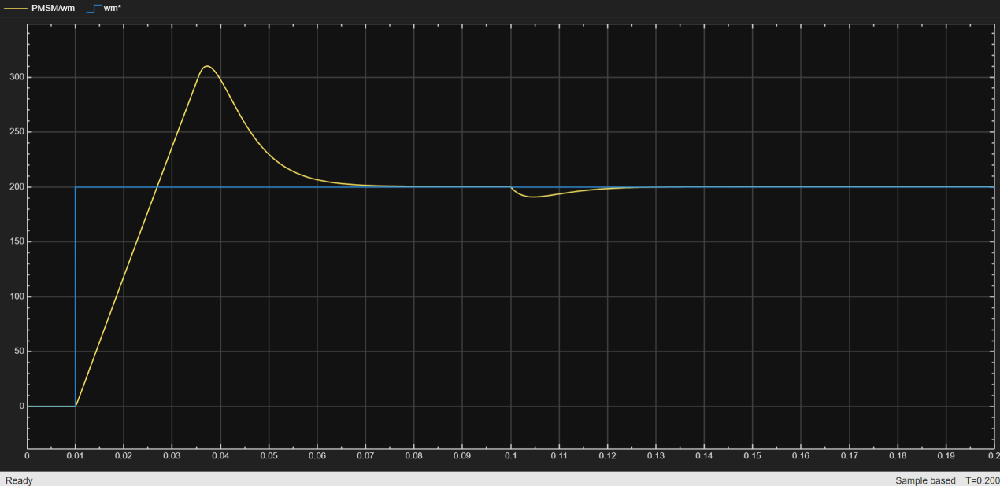
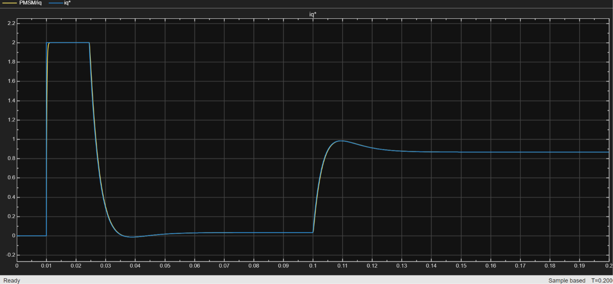
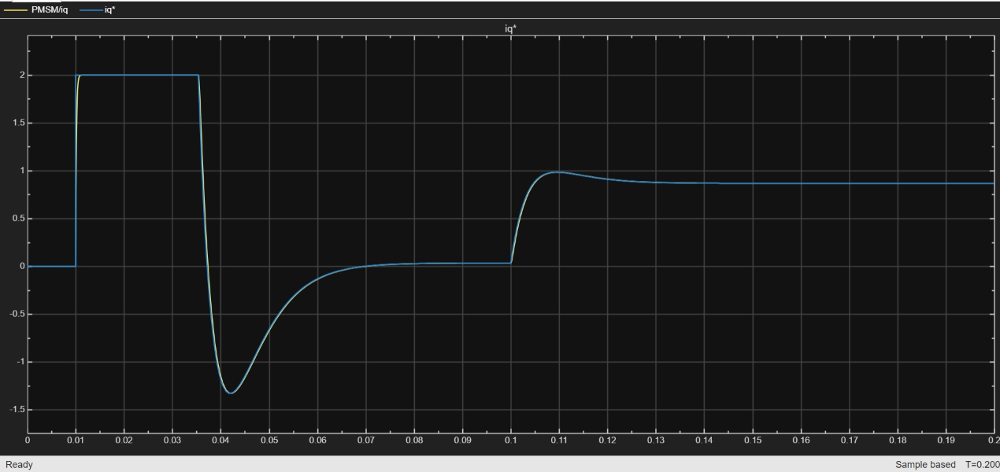

# Commande vectorielle (FOC) d'un PMSM sous Simulink

Modélisation d'un moteur synchrone à aimants permanents dans le repère dq, réglage analytique des régulateurs de courant et validation en simulation. Chaque résultat est comparé à une valeur calculée à la main.

Ce dépôt couvre la première étape du projet : la **boucle de courant avec découplage**. La boucle de vitesse, le défluxage et le portage sur STM32 suivront.

## Contenu

```
.
├── params.m               Paramètres du moteur et gains des régulateurs
├── models/
│   ├── etapeA_RL.slx           Circuit RL de l'axe q, rotor bloqué
│   └── commande_vectorielle_FOC.slx  Moteur dq complet + régulateurs + découplage
├── figures/                    Courbes de validation
```

## Démarche

Le modèle est construit en quatre étapes, avec un essai de validation à chacune.

| Étape | Ajout | Vérification |
|---|---|---|
| A | Circuit RL de l'axe q, rotor bloqué | Constante de temps L/R = 2 ms |
| B | Régulateur PI de courant | Boucle fermée du premier ordre, τ = 1/ωc |
| C | Mécanique, f.é.m. et feedforward | Erreur de traînage sans feedforward, limite de tension |
| D | Axe d, termes croisés et découplage | id maintenu à zéro pendant l'accélération |
| E | Boucle de vitesse en cascade, anti-windup | Dépassement, temps de pic, rejet d'un couple de charge |

## Modèle et réglage

Équations du moteur en convention moteur :

```
vd = Rs·id + Ld·did/dt − ωe·Lq·iq
vq = Rs·iq + Lq·diq/dt + ωe·(Ld·id + ψf)
Te = 1.5·p·[ψf·iq + (Ld − Lq)·id·iq]
J·dωm/dt = Te − TL − B·ωm ,  ωe = p·ωm
```

Loi de commande, un PI par axe avec découplage :

```
vd* = PI(id* − id) − ωe·Lq·iq
vq* = PI(iq* − iq) + ωe·(Ld·id + ψf)
```

Réglage par compensation pôle-zéro : `Kp = L·ωc`, `Ki = Rs·ωc`. La boucle fermée devient un premier ordre de bande passante ωc. Avec fc = 1 kHz pour un découpage à 20 kHz, le retard de 1,5·Ts coûte environ 27° de marge de phase (63° restants).
 
La tension est limitée à Vdc/√3 (zone linéaire SVPWM), avec anti-windup sur les PI et saturation en aval du découplage.
 
La boucle de vitesse est un PI extérieur dont la sortie est la consigne iq*, limitée à ±2 A. La boucle de courant, plus rapide, est vue comme un gain unitaire, et le procédé se réduit à `ωm / iq = Kt / (J·s)`. Le PI est réglé par placement de pôles en second ordre :
 
```
Kpw = 2·ζ·ωn·J / Kt      Kiw = ωn²·J / Kt
```

## Résultats

| Essai | Calculé | Simulé |
|---|---|---|
| B : constante de temps de la boucle de courant | 0,159 ms | 0,160 ms |
| C : iq sans feedforward, pendant l'accélération | 1,85 A | 1,85 à 1,9 A |
| C : iq final à vide | 0,06 A | environ 0,06 A |
| D : id sans découplage, pendant l'accélération | +0,03 A | environ +0,03 A |
| D : id avec découplage | 0 A | 0 A |
| E : sommet de vitesse, échelon de 20 rad/s | 22,71 rad/s (13,5 %) | 22,75 rad/s (13,8 %) |
| E : temps de pic | 10 ms | 10 ms |
| E : creux sous un couple de 0,05 N·m | 10,80 rad/s, 5 ms après | 10,85 rad/s, environ 5,5 ms après |
| E : iq en régime chargé | 0,837 A | 0,84 A |

### Étape B : réponse de la boucle de courant



### Étape C : effet du feedforward de f.é.m.

| Sans feedforward | Avec feedforward |
|---|---|
|  |  |

Sans feedforward, le PI court après une f.é.m. qui croît en rampe (480 V/s) et garde une erreur égale à pente / Ki. Dans les deux cas, le courant s'effondre lorsque la f.é.m. rejoint la tension maximale : c'est la limite que le défluxage repoussera.

### Étape D : effet du découplage

| Avec découplage | Sans découplage |
|---|---|
|  |  |

Le PI seul finit par rejeter le couplage entre axes, mais avec une erreur pendant les transitoires de vitesse. Le découplage la supprime sans attendre l'action intégrale.


### Étape E : boucle de vitesse
 
Échelon de consigne de 20 rad/s à 0,01 s, puis couple de charge de 0,05 N·m à 0,1 s :
 
| Vitesse | Courant |
|---|---|
|  |  |
 
Avec ζ = 1, la réponse indicielle atteint son maximum à t = 2/ωn = 10 ms, avec un dépassement de e⁻² ≈ 13,5 %. Ce dépassement vient du zéro du PI, pas d'un manque d'amortissement. Face à un échelon de charge, le creux vaut (TL/J)·e⁻¹/ωn ≈ 9,2 rad/s, atteint à t = 1/ωn = 5 ms. Les petits écarts restants viennent de la dynamique de la boucle de courant, que le calcul néglige.
 
### Étape E : effet de l'anti-windup
 
Échelon de consigne de 200 rad/s : la consigne de courant sature à 2 A et la vitesse monte en rampe à 12 000 rad/s².
 
| Avec anti-windup (clamping) | Sans anti-windup |
|---|---|
|  |  |
|  |  |
 
Sans anti-windup, l'intégrateur continue d'accumuler l'erreur pendant la saturation. La consigne de courant reste saturée bien après le passage à 200 rad/s, la vitesse monte vers 310 rad/s (environ 55 % de dépassement), et le régulateur doit freiner à −1,3 A pour vider l'intégrateur. Avec le clamping, l'intégrateur est gelé pendant la saturation et le dépassement tombe à environ 2 %.
 
## Lancer la simulation
 
1. Ouvrir MATLAB dans le dossier du dépôt.
2. Exécuter `params.m`.
3. Ouvrir `models/commande_vectorielle_FOC.slx` et lancer la simulation (durée 0,2 s).
4. Les deux interrupteurs manuels activent ou coupent le feedforward de l'axe q et le découplage de l'axe d.
5. La consigne de vitesse et le couple de charge se règlent dans les deux blocs Step `wm*` et `TL`.
Réglages du solveur : pas variable `ode45`, pas maximal `1e-5` s, tolérance relative `1e-4`.
 
Version utilisée : MATLAB/Simulink R20XX (à préciser).
 
## Limites actuelles
 
- Régulateur continu, sans retard de calcul ni de PWM.
- Onduleur idéal, saturation par axe et non sur le module de la tension.
- Mesures parfaites, paramètres du moteur supposés connus.
- Moteur à pôles lisses (Ld = Lq), sans couple de réluctance.
## Suite prévue
 
- [x] Boucle de vitesse (PI extérieur, sortie iq*)
- [ ] Défluxage et limitation du module de la tension
- [ ] Discrétisation du régulateur à 20 kHz
- [ ] Modèle abc avec transformées de Clarke/Park, onduleur et SVPWM
- [ ] Étude de robustesse aux erreurs de paramètres
- [ ] Génération de code (Embedded Coder) et essais sur banc STM32
## Auteur
 
Bangaly Conte
